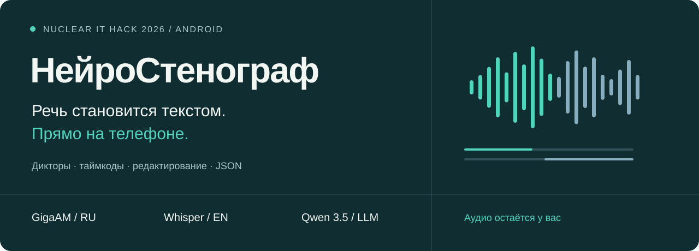
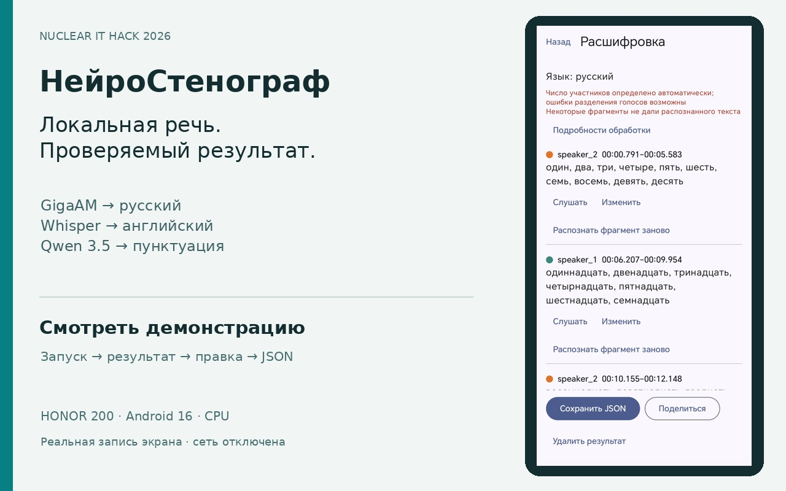
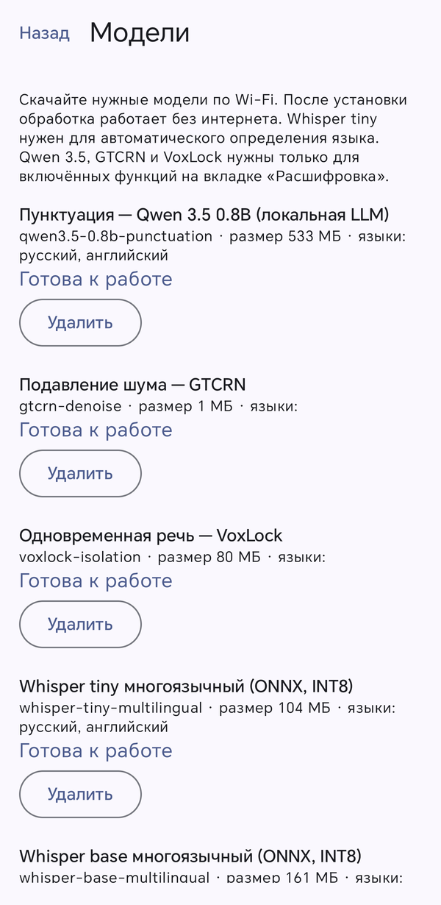
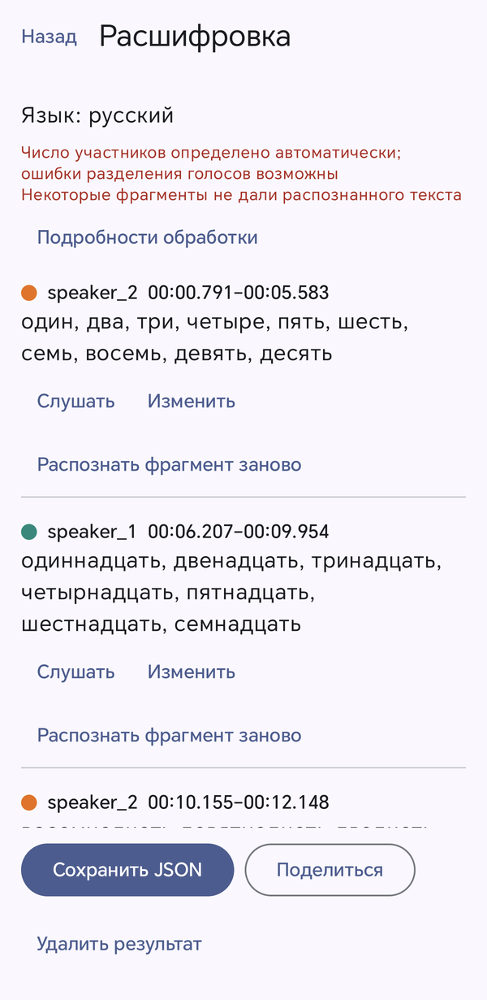
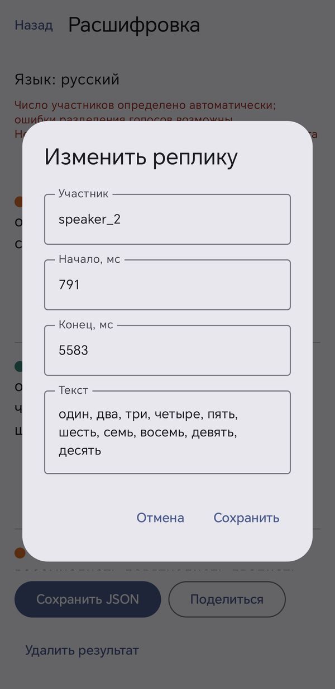
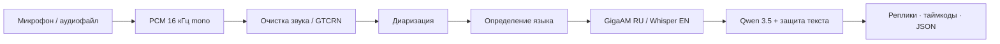

<p align="center">
  
</p>

<p align="center">
  <strong><a href="https://neurosteno-nuclear-hack.honey-kid-1285.chatgpt.site">Сайт проекта</a></strong> ·
  <strong><a href="https://github.com/BazilBaranov/nuclear-hack-neurosteno/releases/latest/download/neurosteno-arm64.apk">Скачать APK</a></strong> ·
  <strong><a href="artifacts/demo/neurosteno-demo.mp4">Смотреть видео</a></strong> ·
  <a href="docs/INSTALLATION.md">Начать работу</a> ·
  <a href="docs/ARCHITECTURE.md">Архитектура</a> ·
  <a href="docs/TEST_RESULTS.md">Результаты</a>
</p>

<p align="center"><b>Android 9+ · ARM64 · Русский / English · GigaAM + Whisper · Локальная Qwen 3.5</b></p>

## Разговор → понятная стенограмма

**НейроСтенограф** превращает запись разговора в реплики с участниками и временными
метками. Запишите звук или импортируйте файл, получите текст, прослушайте спорный
фрагмент, исправьте реплику и экспортируйте JSON. После предварительной загрузки
моделей всё работает на телефоне без доступа к сети.

Русскую речь распознаёт **GigaAM-v3**, английскую — **Whisper**. Диаризация отделяет
говорящих, а локальная **Qwen 3.5** восстанавливает пунктуацию с защитой слов и чисел.
Подавление шума GTCRN и разделение одновременной речи VoxLock включаются по выбору.

| **223 / 223** | **3 / 3** | **14,2 с** | **69,4 МБ** |
|:---:|:---:|:---:|:---:|
| JVM-тесты прошли | Офлайн RU / EN / тишина | На 15,125 с русской речи | APK v0.1.0 без весов моделей |

<sub>Время — один полный проход в debug-инструментации на Honor 200; не оценка точности и не benchmark всех устройств. <a href="docs/TEST_RESULTS.md">Методика и ограничения измерений →</a></sub>

## Посмотрите в работе

<a href="artifacts/demo/neurosteno-demo.mp4"></a>

**[Видео MP4](artifacts/demo/neurosteno-demo.mp4)** · [Экспорт из демонстрации](artifacts/demo/transcript.json) · [Условия записи и главы](artifacts/demo/README.md)

Настоящий экран Honor 200: модели → расшифровка → редактирование → JSON.
Паузы смонтированы; участок обработки показан с исходной скоростью.
**[Открыть публичный сайт проекта](https://neurosteno-nuclear-hack.honey-kid-1285.chatgpt.site)** — видео, архитектура, тесты и инструкции без авторизации.
Исходники и APK в Releases остаются приватными. [Сборка сайта](docs/SITE.md).

<table>
  <tr><th>Модели на устройстве</th><th>Реплики и таймкоды</th><th>Редактирование</th></tr>
  <tr>
    <td></td>
    <td></td>
    <td></td>
  </tr>
</table>

## Семь материалов для сдачи

| № | Материал | Где открыть |
|---|---|---|
| 1 | **APK приложения** | [neurosteno-arm64.apk](https://github.com/BazilBaranov/nuclear-hack-neurosteno/releases/latest/download/neurosteno-arm64.apk) · [SHA-256](https://github.com/BazilBaranov/nuclear-hack-neurosteno/releases/latest/download/SHA256SUMS.txt) |
| 2 | **Исходный код** | [Android-модуль](app/) · [Карта исходников](src/mobile/README.md) |
| 3 | **Установка и использование** | [INSTALLATION.md](docs/INSTALLATION.md) |
| 4 | **Архитектура и модели** | [ARCHITECTURE.md](docs/ARCHITECTURE.md) · [MODELS.md](docs/MODELS.md) |
| 5 | **Ограничения** | [LIMITATIONS.md](docs/LIMITATIONS.md) |
| 6 | **Собственные тесты** | [TEST_RESULTS.md](docs/TEST_RESULTS.md) · [CSV и JSON](artifacts/test-results/) |
| 7 | **Видеодемонстрация** | [MP4](artifacts/demo/neurosteno-demo.mp4) · [Описание](artifacts/demo/README.md) |

> Репозиторий приватный. Для проверки по ссылке организаторам потребуется доступ,
> предоставленный владельцем. APK опубликован в Releases; исходники, документация,
> результаты тестов и видео хранятся в Git. Все материалы доступны по ссылкам выше.

## Первый запуск

1. [Скачайте APK](https://github.com/BazilBaranov/nuclear-hack-neurosteno/releases/latest/download/neurosteno-arm64.apk) из **Releases** и установите на ARM64 Android.
2. **Расшифровка → Выбрать аудио → Расшифровать → Открыть результат.** Whisper small и Pyannote/TitaNet уже в APK v0.3.0.
3. Для английской записи выберите «Английский». Режим языка «Авто» требует Whisper tiny из раздела «Модели».
4. Проверьте текст, при необходимости исправьте и нажмите **Сохранить JSON**.

[Подробная инструкция, размеры моделей и ADB →](docs/INSTALLATION.md)

## Как устроено



Диаризация — Pyannote/TitaNet либо Nemotron. При включённом разделении VoxLock
обрабатывает одновременную речь по чистым образцам из той же записи.
Тяжёлые стадии работают вне UI-потока; результат и пользовательские правки сохраняются атомарно.
[Архитектура](docs/ARCHITECTURE.md) · [Формат данных](docs/PROTOCOL.md) · [Лицензии моделей](docs/speech-model-licenses.md)

## Что доказано, а что ещё предстоит

- **Honor 200:** работает полный CPU-проход; русский GigaAM, английский Whisper,
  локальная LLM, диаризация, шумоподавление и VoxLock реально исполнялись офлайн.
- **Аппаратное исполнение v0.2:** Android 14+ использует дополнительные пакеты LiteRT,
  Android 9–13 запрашивает NNAPI для совместимых ONNX-моделей. [Бэкенды и фолбеки](docs/acceleration.md).
- **Качество:** WER/DER на независимом корпусе не измерены. Метки дикторов и спорные
  реплики требуют проверки; успешные технические тесты не гарантируют точность.

[Полные ограничения](docs/LIMITATIONS.md) · [Протокол измерений](docs/VALIDATION.md)

## Собрать самостоятельно

Из корня репозитория, с установленными JDK 17 и Android SDK:

```bash
export VULKAN_SDK="$PWD/artifacts/build/vulkan-tools/usr"

./scripts/prepare-nnapi.sh &&
  ./scripts/prepare-vulkan-tools.sh &&
  ./scripts/prepare-bundled-models.sh &&
  ./scripts/build.sh :app:assembleOptimized
```

Выход: `app/build/outputs/apk/optimized/app-optimized.apk`.
[Все зависимости и команды](docs/INSTALLATION.md#сборка-из-исходников) · [Проверки](docs/TESTING.md)

## Навигация по репозиторию

```text
app/                    рабочий Android-модуль: Kotlin, Compose, JNI
src/mobile/             карта исходников и вход для шаблона сдачи
config/                 карта конфигурации и зависимостей
scripts/                подготовка runtime, сборка, проверка поставки
tests/                  метрики и синтетические fixtures
docs/                   инструкции, архитектура, модели, ограничения, отчёты
artifacts/apk/          ссылка на релиз и контрольная сумма
artifacts/demo/         видео и настоящий экспорт JSON
artifacts/test-results/ результаты проверок в CSV/JSON
```

Структура отчётных материалов адаптирована из
[шаблона Nuclear IT Hack](https://github.com/grigorevmp/hacathon_template).
Канонический Gradle-модуль сохранён в `app/`, чтобы не менять рабочую сборку.
Исходная база — GitLab `nuclear-it-hack-2026/neurostenografist`, ветка `plan`, коммит `e6987c4`.
Веса, личные файлы телефона и сборочные кэши не публикуются. Уведомления и лицензии
зависимостей сохранены в исходниках и ресурсах APK.
